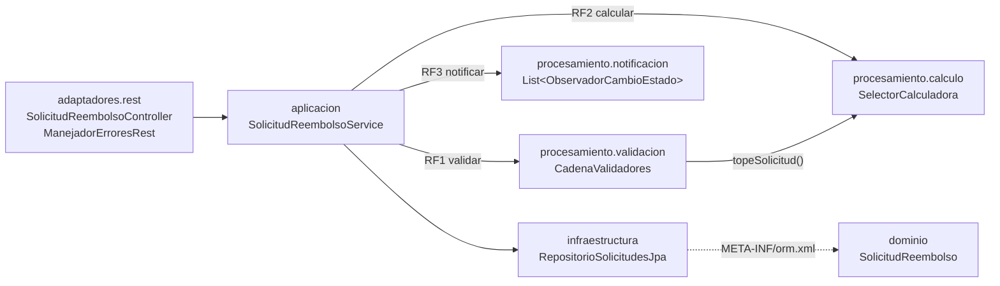
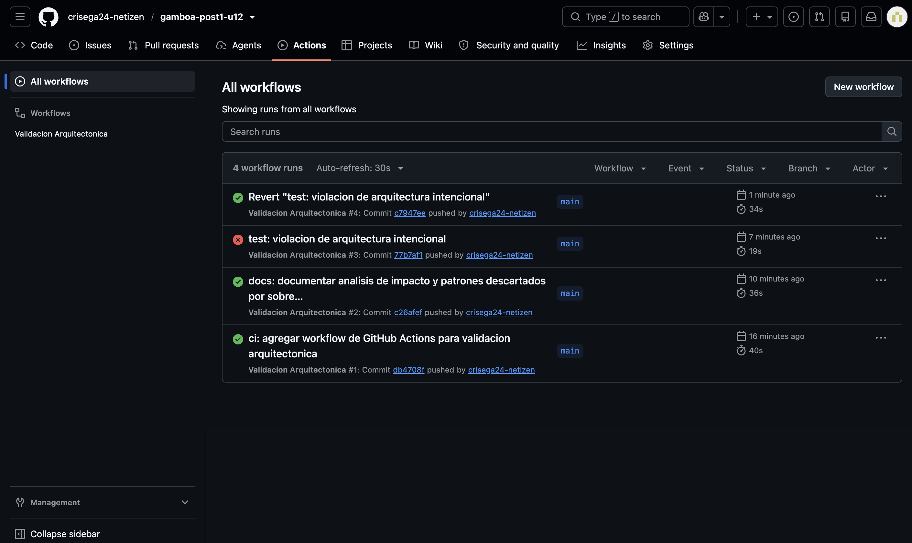
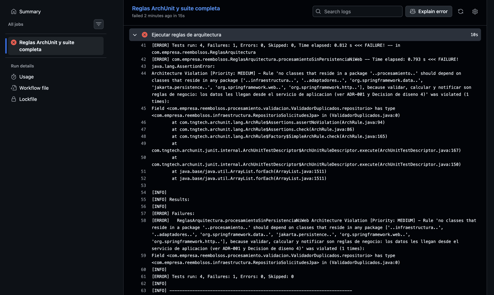

# Proyecto Integrador: Sistema de Solicitudes de Reembolso de Gastos Corporativos

**Post-contenido — Unidad 12 · Patrones de Diseño de Software**
Juan Sebastián Gamboa Cristancho · Universidad de Santander (UDES) · Cúcuta, 2026

Sistema Spring Boot que reemplaza la hoja de cálculo del área de Finanzas para gestionar solicitudes de reembolso de gastos. Los empleados registran la categoría, el monto, la fecha del gasto y si adjuntaron los documentos soporte; el sistema valida la solicitud, calcula el monto aprobado y notifica a los interesados cada vez que la solicitud cambia de estado.

## Contenido

1. [Diseño Propuesto](#diseño-propuesto) *(escrito antes del código)*
2. [Arquitectura resultante](#arquitectura-resultante)
3. [Decisiones de diseño 1 a 4](#decisiones-de-diseño)
4. [ADR-001 (resumen)](#adr-001-resumen)
5. [Qué se descartó y por qué](#qué-se-descartó-y-por-qué)
6. [Validación arquitectónica en GitHub Actions](#validación-arquitectónica-en-github-actions)
7. [Hallazgos sobre el código de referencia de la guía](#hallazgos-sobre-el-código-de-referencia-de-la-guía)
8. [Pruebas](#pruebas)
9. [Ejecución](#ejecución)

---

## Diseño Propuesto

*Sección escrita antes de implementar cualquier patrón (primer commit del repositorio). Para cada requisito se identifica primero qué varía, y solo después qué patrón lo resuelve, aplicando el test de explicabilidad de la Guía (sección 1.2): si la razón de un patrón no cabe en una oración, probablemente no se necesita.*

| Requisito | Punto de variabilidad concreto | Patrón propuesto |
|-----------|--------------------------------|------------------|
| **RF1** — Validación en varias etapas | El **número y el orden** de las verificaciones: hoy son tres (tope de la categoría, documentos soporte, duplicado en el período) y Finanzas ya anunció una cuarta (límite anual acumulado). Cada verificación es independiente y cualquiera puede detener la aprobación. | **Chain of Responsibility** |
| **RF2** — Cálculo distinto por categoría | La **fórmula del monto aprobado**, que depende de la categoría: tope diario × días (viaje), monto completo hasta un tope mensual (representación) y 80 % hasta un tope anual (capacitación). Habrá categorías nuevas, como «bienestar». | **Strategy** |
| **RF3** — Notificación simultánea | El **conjunto de interesados** y su forma de reaccionar a un cambio de estado: el empleado (todo resultado), Contabilidad (solo aprobaciones) y auditoría (todo, sin excepción). Ya se anunció un cuarto interesado: el panel de métricas. | **Observer** |

### Justificación de cada patrón (test de explicabilidad)

- **RF1 → Chain of Responsibility:** cada verificación es un eslabón que decide si la solicitud continúa o se rechaza sin conocer a los demás eslabones, de modo que el límite anual acumulado se agrega como un eslabón nuevo sin modificar los tres existentes.
  - *Por qué no otro:* Strategy elige **una** alternativa entre varias, pero aquí deben ejecutarse **todas** en secuencia. Decorator añadiría comportamiento alrededor de un objeto, pero no expresa «cortar el flujo al primer rechazo».
- **RF2 → Strategy:** cada categoría es un algoritmo intercambiable que produce el mismo resultado (el monto aprobado) con su propia fórmula, seleccionado una sola vez por la categoría de la solicitud, así que «bienestar» será una clase nueva y no una rama más en un `switch`.
  - *Por qué no otro:* State no aplica, porque la categoría no cambia durante la vida de la solicitud ni tiene transiciones. Template Method exigiría un esqueleto común que las tres fórmulas no comparten: no tienen pasos en común, solo la firma.
- **RF3 → Observer:** el cambio de estado es un evento con varios receptores, cada uno con su propia reacción, y el servicio central debe notificarlos sin conocerlos, para que el panel de métricas se sume como un suscriptor nuevo.
  - *Por qué no otro:* Mediator coordinaría interacciones **entre** los interesados, pero aquí los interesados no se comunican entre sí; solo reaccionan al mismo hecho.

### Criterios de composición consciente aplicados al conjunto

Los tres patrones conviven en el mismo flujo y cada uno pasa los criterios de la Guía:

- **Problema distinto:** validar, calcular y notificar son decisiones independientes; ningún patrón resuelve el problema de otro.
- **Variación real:** las tres variaciones están **documentadas en la especificación**, con al menos un caso futuro anunciado por Finanzas para cada una (límite anual acumulado, categoría «bienestar», panel de métricas). No son variaciones especulativas.
- **Interfaz natural:** la cadena de validación entrega una solicitud válida que la estrategia de cálculo consume, y el resultado persistido es lo que los observadores reciben. No hace falta ningún adaptador entre ellos.
- **Saturación:** son tres patrones, uno por requisito, coordinados en un único servicio de aplicación. Cualquier patrón adicional deberá pasar el mismo análisis antes de entrar al diseño.

### Estructura de paquetes prevista

```
src/main/java/com/empresa/reembolsos/
├── ReembolsosApplication.java
├── dominio/            ← SolicitudReembolso, CategoriaGasto, EstadoSolicitud (sin Spring ni JPA)
├── procesamiento/
│   ├── validacion/     ← RF1: Chain of Responsibility
│   ├── calculo/        ← RF2: Strategy
│   └── notificacion/   ← RF3: Observer
├── aplicacion/         ← SolicitudReembolsoService: único punto que coordina los tres patrones
├── infraestructura/    ← RepositorioSolicitudesJpa
└── adaptadores/rest/   ← SolicitudReembolsoController
```

---

## Arquitectura resultante

El sistema quedó en **capas simples** (ver [ADR-001](docs/adr/ADR-001.md)), con los tres patrones aislados en `procesamiento` y coordinados por un único servicio de aplicación:



| Paquete | Contenido | Límite verificado por ArchUnit |
|---------|-----------|--------------------------------|
| `dominio` | `SolicitudReembolso`, `CategoriaGasto`, `EstadoSolicitud`: objetos Java planos, sin Spring ni JPA | El mapeo JPA vive en `META-INF/orm.xml` |
| `procesamiento.validacion` | **Chain of Responsibility:** `ValidadorSolicitud` (abstracto) → `ValidadorDocumentosSoporte` → `ValidadorMontoMaximo` → `ValidadorDuplicados`, ensamblados en `CadenaValidadores` | Regla 1: sin infraestructura, adaptadores, JPA ni web |
| `procesamiento.calculo` | **Strategy:** `CalculadoraReembolso` y sus 3 estrategias, más `SelectorCalculadora` | Reglas 1 y 3 |
| `procesamiento.notificacion` | **Observer:** `ObservadorCambioEstado` y los notificadores de Empleado, Contabilidad y Auditoría | Reglas 1 y 4 |
| `aplicacion` | `SolicitudReembolsoService` (coordina los tres patrones), `SolicitudInvalidaException`, `SolicitudNoEncontradaException` | — |
| `infraestructura` | `RepositorioSolicitudesJpa` (Spring Data JPA, sin puerto intermedio) | — |
| `adaptadores.rest` | `POST /api/solicitudes`, `PUT /api/solicitudes/{id}/estado`, y errores 400/404 en formato Problem Details | Regla 2: solo servicio y dominio |

**Flujo de una solicitud:**

1. `POST /api/solicitudes` → el servicio carga las solicitudes **pendientes** del empleado y las pasa con la nueva por la **cadena de validación** (RF1). El primer eslabón que la rechaza corta la cadena, y la API responde **400** con el motivo.
2. Si es válida, la **estrategia de su categoría** calcula el monto aprobado (RF2), y la solicitud se guarda como `PENDIENTE`.
3. `PUT /api/solicitudes/{id}/estado` → el servicio guarda el nuevo estado y **después** notifica a todos los **observadores** (RF3). Cada uno decide si el cambio le interesa.

---

## Decisiones de diseño

### Decisión 1 — Orden de la cadena de validación (RF1)

**Orden elegido:** `documentos → monto → duplicados`, ensamblado en un único lugar (`CadenaValidadores`).

| Eslabón | Qué hace | Costo |
|---------|----------|-------|
| `ValidadorDocumentosSoporte` | Lee un booleano de la solicitud | Constante: una comparación |
| `ValidadorMontoMaximo` | Pide el tope a la estrategia de la categoría y compara | Constante: búsqueda en un mapa y una comparación |
| `ValidadorDuplicados` | Recorre las solicitudes pendientes del empleado | Lineal: crece con el número de pendientes |

**Justificación (eficiencia):** la cadena se corta en el primer rechazo, así que conviene poner primero los eslabones baratos y que más rechazan, y dejar al final el más costoso. Con este orden, el recorrido de la lista solo se ejecuta para las solicitudes que ya tienen documentos y un monto dentro del tope. La prueba `CadenaValidadoresTest` lo comprueba contando cuántas veces se ejecuta el último eslabón.

- **Qué se gana:** las solicitudes sin documentos o con un monto excesivo, los errores más comunes al diligenciar el formulario, se rechazan sin recorrer la lista.
- **Qué se pierde:** si una solicitud incumple varias reglas, el empleado solo recibe el **primer** motivo. Al corregirlo puede descubrir el siguiente en un segundo intento. Ponerlo primero no evitaría esa pérdida, solo cambiaría cuál motivo se ve, y costaría recorrer la lista en todas las solicitudes, incluso las que se rechazarían por una regla trivial.
- **Cuándo reconsiderarlo:** si Finanzas pide informar **todos** los motivos a la vez, el problema deja de ser «cortar al primer rechazo» y la cadena debería acumular resultados en vez de detenerse.

### Decisión 2 — Selección de la estrategia de cálculo (RF2)

**Mecanismo elegido:** un `Map<CategoriaGasto, CalculadoraReembolso>` que `SelectorCalculadora` construye a partir de la `List<CalculadoraReembolso>` que Spring inyecta con todos los `@Component` registrados.

```java
public SelectorCalculadora(List<CalculadoraReembolso> lista) {
    this.calculadoras = lista.stream()
            .collect(Collectors.toMap(CalculadoraReembolso::getCategoria, Function.identity()));
}
```

**Justificación (RF2):** Finanzas planea agregar categorías nuevas sin modificar el código existente.

- Con el **mapa inyectado**, la categoría «bienestar» requiere un valor nuevo en el enum y una clase `CalculadoraBienestar` anotada con `@Component`. Spring la agrega a la lista y el selector la registra sola, sin tocar ninguna línea ya escrita del selector ni de las demás calculadoras. Cumple el principio Abierto/Cerrado.
- Con un **`switch` manual**, cada categoría nueva obliga a editar el método selector y a volver a probarlo, y es fácil olvidar un `case` (el error aparecería en tiempo de ejecución).
- **Costo aceptado:** el registro es implícito, porque no hay una lista visible de categorías en el código. Para compensarlo, `obtener()` falla con un mensaje claro (`Categoria no soportada: …`) si falta una estrategia, y `SelectorCalculadoraTest` cubre ese caso. Además, `Collectors.toMap` falla al iniciar la aplicación si dos calculadoras declaran la misma categoría, en vez de escoger una al azar.

### Decisión 3 — Capas simples o Hexagonal (documentada en ADR-001)

**Decisión:** la persistencia se mantiene en **capas simples**: `SolicitudReembolsoService` depende directamente de `RepositorioSolicitudesJpa`. En la notificación **no se introduce ningún cambio**, porque `ObservadorCambioEstado` ya es el seam para la integración de Contabilidad anunciada.

**Justificación:** el criterio de la Guía (sección 6.2) para Hexagonal es durar 3 años o más **con cambios de infraestructura**. Ese criterio se aplicó por separado a cada dependencia externa, con los datos del proyecto, y da una respuesta distinta para cada una. El análisis completo, con las alternativas evaluadas y las consecuencias, está en [`docs/adr/ADR-001.md`](docs/adr/ADR-001.md), y su resumen en la sección siguiente.

### Decisión 4 — Qué partes de Spring se admiten en `procesamiento` (Regla 1 de ArchUnit)

**Decisión:** la Regla 1 prohíbe que `procesamiento` dependa de `org.springframework.data`, `jakarta.persistence`, `org.springframework.web`, `org.springframework.http`, `..infraestructura..` y `..adaptadores..`. **No** prohíbe todo `org.springframework`, porque las 11 clases del paquete (3 calculadoras, el selector, 3 validadores, la cadena y 3 notificadores) usan `@Component`.

**Justificación:** la regla debe proteger contra el acoplamiento que de verdad daña, y no contra cualquier `import` con la palabra Spring.

- **Las anotaciones de estereotipo (`@Component`) son metadatos para el contenedor.** Le dicen a Spring qué instancias crear, pero no cambian lo que hace la clase ni la atan a una tecnología de infraestructura. La prueba está en el propio proyecto: las 39 pruebas unitarias de `procesamiento` crean los validadores, las calculadoras y los notificadores con `new`, sin levantar ningún contexto de Spring. Si mañana se quitara Spring, solo habría que mover el ensamblado a una clase de configuración, y la lógica no cambiaría.
- **Las clases de acceso a datos o de la capa web meten decisiones de infraestructura dentro de las reglas de negocio:** transacciones, consultas a la base de datos, códigos HTTP. Ese es justo el acoplamiento que ADR-001 da por inexistente. Por ejemplo, `ValidadorDuplicados` recibe la lista de pendientes en vez de consultarla, y la futura API de Contabilidad irá en `infraestructura`, no en `procesamiento`.
- **Prohibir todo `org.springframework`** obligaría a reemplazar los 11 `@Component` por métodos `@Bean` en una clase de configuración. Serían 11 métodos de código repetitivo sin ninguna ganancia real de desacoplamiento, y además se perdería el registro automático de estrategias y observadores que justifica la Decisión 2.

**Refinamiento propio:** la regla de la guía solo prohibía datos y persistencia. Como esta decisión argumenta que la capa web tampoco es aceptable, se agregaron `org.springframework.web..` y `org.springframework.http..` para que la regla haga cumplir lo que la decisión afirma.

---

## ADR-001 (resumen)

> Documento completo: [`docs/adr/ADR-001.md`](docs/adr/ADR-001.md) · **Estado:** Aceptado · **Fecha:** 2026-10-31

| | Persistencia (Spring Data JPA + H2) | Notificación a Contabilidad |
|---|---|---|
| **¿Cambio de infraestructura previsto?** | **No.** No hay plan de cambiar el motor de base de datos. | **Sí, con fecha:** integración por API externa el próximo trimestre. |
| **Superficie de contacto hoy** | 1 clase (`SolicitudReembolsoService`) con 3 métodos (`findByEmpleadoIdAndEstado`, `findById`, `save`) | El servicio solo conoce `List<ObservadorCambioEstado>` |
| **Decisión** | **Capas simples.** Un puerto hoy sería YAGNI: una abstracción con una única implementación posible. | **Ningún cambio.** La API se implementará como un nuevo observador en `infraestructura` (`NotificadorContabilidadApi`), que reemplazará a `NotificadorContabilidad`. |

**Alternativas evaluadas:**
1. Hexagonal completa.
2. Hexagonal solo para la persistencia.
3. Capas simples (**elegida**).

**Consecuencias positivas:**
- No hay interfaces ni adaptadores sin un caso de uso que los justifique.
- El único cambio con fecha ya tiene su punto de extensión.
- La deuda es pequeña y acotada: gracias a `orm.xml` no harían falta mappers, y la Regla 1 impide que JPA se filtre a `procesamiento`. Introducir el puerto costaría una interfaz de 3 métodos y un cambio de tipo en un constructor.

**Consecuencias negativas:**
- Si se cambia de motor de base de datos, el puerto deberá introducirse retroactivamente.
- El servicio sigue acoplado a Spring Data, por eso se cubre con la prueba de integración.
- La asimetría entre persistencia y notificación puede parecer inconsistente sin leer el ADR.
- **Riesgo identificado:** los observadores se ejecutan en secuencia. Una falla de la futura API externa impediría notificar a los siguientes, así que deberá aislarse dentro del nuevo observador.

**Señales para revisar la decisión:**
- Un plan concreto de cambio de motor de base de datos o de un segundo almacenamiento.
- Una segunda aplicación que reutilice el servicio sin JPA.
- Que la integración de Contabilidad exija más que un observador nuevo.

---

## Qué se descartó y por qué

Durante el diseño y la implementación se consideraron alternativas más sofisticadas que las que se construyeron. Cada una se evaluó con la misma pregunta de la Guía (sección 4.2): **¿la variabilidad que la justificaría es real y está documentada hoy, o es especulación sobre un futuro que aún no llegó?** Ningún descarte es definitivo. Cada uno es la decisión vigente hoy, junto con la señal concreta que haría reabrirla.

| # | Alternativa considerada | Origen | Principio que la descarta | Señal para reconsiderarla |
|---|-------------------------|--------|---------------------------|---------------------------|
| 1 | `ApplicationEventPublisher` + `@EventListener` en vez de `List<ObservadorCambioEstado>` | Ejemplo de la guía | Test de explicabilidad | Observadores asíncronos, o que deban esperar al *commit* |
| 2 | Visitor o Abstract Factory para exportar reportes en varios formatos | Ejemplo de la guía | YAGNI y Rule of Three | Un segundo formato pedido de verdad |
| 3 | **Patrón State** para las transiciones de `EstadoSolicitud` | Propio | Test de explicabilidad y YAGNI | Finanzas define un flujo con transiciones prohibidas o comportamiento por estado |
| 4 | **Entidad JPA separada + mapper** (`SolicitudReembolsoEntity`) | Propio | YAGNI | El modelo de la tabla deja de coincidir con el del dominio |
| 5 | **Topes en configuración externa** (`@ConfigurationProperties`) | Propio | Rule of Three | Finanzas pide ajustar topes sin desplegar una versión nueva |

### 1. Spring `ApplicationEventPublisher` en vez de una lista de observadores inyectada *(ejemplo de referencia)*

- **Qué se consideró:** publicar un evento de dominio (`SolicitudEstadoCambiadoEvent`) con `ApplicationEventPublisher` y que cada interesado lo escuchara con `@EventListener`, como muestra la Guía (sección 2.3), en lugar de inyectar `List<ObservadorCambioEstado>` en el servicio.
- **Por qué se descartó:** con exactamente tres observadores fijos y conocidos en tiempo de compilación, el bus de eventos genérico no aporta desacoplamiento real, porque la interfaz `ObservadorCambioEstado` ya lo logra. En cambio, dificulta rastrear en el código quién reacciona a qué cambio: con la lista basta con buscar las implementaciones de la interfaz. Es el mismo costo de depuración que la Guía advierte sobre Observer con eventos. No pasa el test de explicabilidad, porque no hay una oración que justifique la indirección adicional con los requisitos actuales.
- **Señal para reconsiderarlo:** la integración con la API de Contabilidad (ADR-001). Si esa llamada debe ejecutarse **después del *commit*** o **en segundo plano**, para que una API lenta no bloquee la respuesta HTTP, `@TransactionalEventListener` y `@Async` resuelven exactamente eso, y el bus pasaría a aportar algo que la lista no da.

### 2. Visitor o Abstract Factory para exportar reportes en varios formatos *(ejemplo de referencia)*

- **Qué se consideró:** anticipar que Contabilidad pediría exportar el historial de solicitudes en PDF, Excel y CSV, y construir desde ahora una jerarquía de exportadores.
- **Por qué se descartó:** en este proyecto la variabilidad ni siquiera existe. La especificación no tiene **ningún** requisito de exportación. Lo más cercano es el reporte trimestral de auditoría, que se alimenta del registro que ya deja `NotificadorAuditoria`. Sin un primer formato, mucho menos tres, la Rule of Three de la Guía (sección 4.2) no se cumple, y construir la abstracción ahora sería resolver un problema que todavía no existe (YAGNI).
- **Señal para reconsiderarlo:** el primer requisito real de exportación se implementa como una clase simple. Solo cuando llegue un **segundo formato pedido** y se vea qué tienen en común ambos, se extrae la abstracción, con base en dos casos reales y no imaginados.

### 3. Patrón State para las transiciones de la solicitud *(propio)*

- **Qué se consideró:** al implementar `cambiarEstado`, se notó que el servicio acepta **cualquier** transición. Por ejemplo, una solicitud `APROBADA` puede volver a `PENDIENTE`, y el cambio se notifica a los tres observadores. Se consideró modelar cada estado como una clase (`EstadoPendiente`, `EstadoAprobada`…) con el patrón State, para que cada estado decidiera qué transiciones admite.
- **Por qué se descartó:** la especificación **no define reglas de transición**. Solo enumera los estados y pide notificar cada cambio. Inventarlas sería decidir reglas de negocio que Finanzas no ha pedido. Además, el único comportamiento que hoy depende del estado («Contabilidad solo reacciona a APROBADA») ya está resuelto dentro de `NotificadorContabilidad`. Moverlo a State lo dispersaría en cuatro clases sin ganar nada. No pasa el test de explicabilidad: la única justificación posible sería «por si las transiciones se vuelven complejas».
- **Señal para reconsiderarlo:** que Finanzas defina un flujo con transiciones prohibidas (por ejemplo, «una solicitud aprobada no puede reabrirse») o **comportamiento distinto según el estado** (por ejemplo, «en `REQUIERE_CORRECCION` el empleado puede editar el monto, en los demás no»). Si solo aparecen una o dos transiciones prohibidas, bastaría una validación en el servicio. State se justificaría cuando el comportamiento por estado crezca.

### 4. Entidad JPA separada del modelo de dominio, con su mapper *(propio)*

- **Qué se consideró:** para cumplir el checkpoint de un dominio sin JPA (hallazgo 3), la solución habitual en Hexagonal es duplicar el modelo: una `SolicitudReembolsoEntity` anotada con `@Entity` en `infraestructura`, más un mapper que copie los datos entre la entidad y `SolicitudReembolso`.
- **Por qué se descartó:** las dos clases tendrían **exactamente los mismos 9 campos**. El mapper sería código de copia sin ninguna transformación, que habría que mantener sincronizado cada vez que se agregue un campo, y que puede introducir errores silenciosos si se olvida uno. El mapeo en `orm.xml` da la misma independencia del dominio con un solo archivo declarativo y sin código repetido (YAGNI). Además, es coherente con ADR-001: no se construye la infraestructura de Hexagonal sin un motivo real.
- **Señal para reconsiderarlo:** que el modelo de persistencia **deje de coincidir** con el de dominio. Por ejemplo: columnas técnicas de auditoría (`creado_por`, `version`) que el dominio no debe ver, una tabla separada para los documentos soporte, o un segundo almacenamiento con otra estructura. Ahí el mapper sí haría una transformación real.

### 5. Topes de reembolso en configuración externa *(propio)*

- **Qué se consideró:** al corregir el hallazgo 1 y llevar los topes a cada estrategia, se pensó en sacarlos a `application.properties` con una clase `@ConfigurationProperties` (por ejemplo, `reembolsos.topes.viaje-diario=150000`), para que Finanzas pudiera cambiarlos sin modificar código.
- **Por qué se descartó:** los topes son parte de la fórmula de cada categoría. Cada estrategia los usa de una manera distinta (diario, mensual o anual, con o sin porcentaje), y la especificación no menciona que cambien ni que Finanzas quiera ajustarlos por su cuenta. Externalizarlos agregaría una segunda fuente de verdad para algo que hoy no varía. Además, cada categoría nueva necesitaría su propia configuración, así que agregar «bienestar» ya no sería solo crear una clase. No hay ni un caso de ajuste de topes, menos los tres de la Rule of Three.
- **Señal para reconsiderarlo:** que Finanzas pida **ajustar un tope sin desplegar** una versión nueva, por ejemplo el reajuste anual por inflación. Como los topes ya están en un solo lugar (`topeSolicitud` de cada estrategia), moverlos a configuración tocaría solo las tres calculadoras.

---

## Validación arquitectónica en GitHub Actions

El workflow [`.github/workflows/arquitectura.yml`](.github/workflows/arquitectura.yml) se ejecuta en cada push y pull request a `main`:
1. Primero corre `./mvnw test -Dtest=ReglasArquitectura`.
2. Después corre la suite completa con `./mvnw verify`.

Usa `actions/checkout@v5` y `actions/setup-java@v5` con caché de Maven integrada, en lugar de las `@v4` y de `actions/cache@v3` de la guía, que ya están obsoletas.

### Reglas de arquitectura (`ReglasArquitectura.java`)

| # | Regla | Qué protege |
|---|-------|-------------|
| 1 | `procesamientoSinPersistenciaNiWeb` | Los tres patrones no dependen de `infraestructura`, `adaptadores`, Spring Data, JPA ni la capa web (Decisión 4) |
| 2 | `controladorSoloUsaServicioYDominio` | El adaptador REST no se salta el servicio de aplicación |
| 3 | `calculadorasImplementanCalculadoraReembolso` | Toda clase `Calculadora*` es una estrategia de RF2 |
| 4 | `notificadoresImplementanObservadorCambioEstado` | Todo lo que vive en `notificacion` es un observador de RF3 |

### Prueba de una violación intencional

Para comprobar que el pipeline de verdad protege los límites, se introdujo a propósito un «atajo»: el validador de duplicados consulta la base de datos directamente, en vez de recibir la lista de pendientes desde el servicio.

```java
// ValidadorDuplicados.java — commit 77b7af1 (revertido en c7947ee)
@Autowired
private RepositorioSolicitudesJpa repositorio;   // procesamiento → infraestructura
```

La violación **compila y no rompe ninguna prueba funcional**: el campo no cambia el comportamiento. Solo ArchUnit la detecta. Se declaró un campo y no solo un `import`, porque un import sin usar desaparece al compilar y ArchUnit analiza el código compilado.

**Historial de builds:**
- ✅ #1 y #2: estado inicial.
- ❌ #3 (`77b7af1`): la violación intencional.
- ✅ #4 (`c7947ee`): se corrigió con `git revert`, que conserva en el historial tanto el error como su corrección.



**Detalle del build fallido:** el job se detiene en el paso «Ejecutar reglas de arquitectura», y ArchUnit identifica la regla, el motivo (`because ...`) y la línea exacta de la violación: `Field <...ValidadorDuplicados.repositorio> has type <...infraestructura.RepositorioSolicitudesJpa>`.



---

## Hallazgos sobre el código de referencia de la guía

Al implementar se encontraron siete inconsistencias en el código de ejemplo de la guía, y cada una se corrigió:

1. **Tope de viaje contradictorio.** El `ValidadorMontoMaximo` de la guía usa un tope fijo de 150.000 para VIAJE, pero la calculadora reembolsa 150.000 **por día**. Un viaje de 3 días por 400.000 sería rechazado por la validación aunque el cálculo lo permite (tope real: 450.000). **Corrección:** cada estrategia expone `topeSolicitud(solicitud)` y el validador se lo pregunta a la estrategia de la categoría. Los topes quedan definidos en un solo lugar, y una categoría nueva no obliga a modificar el validador. Lo cubre el primer caso de `ValidadorMontoMaximoTest`.
2. **Duplicados que ignoran el año.** El `ValidadorDuplicados` de la guía compara solo `getMonth()`, de modo que una solicitud pendiente de octubre de 2025 bloquearía una de octubre de 2026. **Corrección:** se compara el período completo con `YearMonth` (mes y año). Lo cubre `ValidadorDuplicadosTest.apruebaElMismoMesDeOtroAnio`.
3. **Dominio «sin JPA» que JPA no puede persistir.** El checkpoint exige que el paquete `dominio` no importe nada de Spring ni de JPA, pero `RepositorioSolicitudesJpa extends JpaRepository<SolicitudReembolso, Long>` necesita que `SolicitudReembolso` sea una entidad. La guía no indica cómo conciliar ambas cosas. **Corrección:** el mapeo se declara en XML (`src/main/resources/META-INF/orm.xml`, con acceso por campos), que es parte del estándar JPA. La clase de dominio sigue siendo un objeto Java plano, y el detalle de persistencia (tabla, identificador autogenerado, enums guardados como texto) queda en la infraestructura.
4. **Regla 3 de ArchUnit imposible de cumplir.** La regla de la guía exige que *todas* las clases no interfaz de `procesamiento.calculo` implementen `CalculadoraReembolso`, pero el propio código de la guía coloca `SelectorCalculadora` en ese paquete, y el selector no es una estrategia. **Corrección:** la regla se acota a las clases cuyo nombre empieza por `Calculadora` (`.and().haveSimpleNameStartingWith("Calculadora")`). Así se convierte en una convención verificable: toda clase `Calculadora*` del paquete debe ser una estrategia.
5. **Las reglas también analizaban las pruebas.** Con `@AnalyzeClasses(packages = "com.empresa.reembolsos")`, ArchUnit importa también las clases de `src/test`, que viven en los mismos paquetes. `CalculadoraViajeTest` incumpliría la Regla 3, y `NotificadorEmpleadoTest` la Regla 4. **Corrección:** se usa `importOptions = ImportOption.DoNotIncludeTests.class`, de modo que las reglas evalúan solo el código de producción.
6. **Regla 2 de ArchUnit que el propio controlador incumple.** La regla de la guía solo permite que `adaptadores.rest` acceda a `aplicacion`, `dominio`, `org.springframework.web`, `org.springframework.http` y `java`. Pero ArchUnit cuenta como acceso que el controlador lea **su propio campo** `servicio`, así que la regla falló 3 veces sin que hubiera ninguna violación real. **Corrección:** se agregó el propio paquete `..adaptadores.rest..` a los permitidos. La regla sigue prohibiendo lo que importa: que el controlador llegue a `procesamiento` o a `infraestructura` saltándose el servicio.
7. **Las reglas no se ejecutaban en la suite completa.** Surefire solo ejecuta por defecto las clases cuyo nombre termina en `Test`, `Tests` o `TestCase`, o empieza por `Test`, y `ReglasArquitectura` no cumple ninguno de esos patrones. `mvn test -Dtest=ReglasArquitectura` sí las corría, pero `mvn test` y `mvn verify` las ignoraban en silencio: el paso «suite completa» del pipeline no las incluía. **Corrección:** se configuró `maven-surefire-plugin` en el `pom.xml` para incluir `**/ReglasArquitectura.java`, sin renombrar la clase que pide la guía.

---

## Pruebas

**52 pruebas en total.** Todas se ejecutan con `./mvnw test`, y también en el pipeline.

| Tipo | Clase | Pruebas | Qué verifica |
|------|-------|:-------:|--------------|
| Unitaria (RF2) | `CalculadoraViajeTest` | 3 | Tope diario × días: bajo el tope, en el tope y sobre el tope |
| Unitaria (RF2) | `CalculadoraRepresentacionTest` | 3 | Monto completo hasta el tope mensual |
| Unitaria (RF2) | `CalculadoraCapacitacionTest` | 3 | 80 % hasta el tope anual |
| Unitaria (RF2) | `SelectorCalculadoraTest` | 2 | Entrega la estrategia de cada categoría y rechaza una no registrada |
| Unitaria (RF1) | `ValidadorDocumentosSoporteTest` | 2 | Con y sin documentos |
| Unitaria (RF1) | `ValidadorMontoMaximoTest` | 8 | Topes de las 3 categorías tomados de la estrategia (incluido el viaje de 3 días por 400.000) |
| Unitaria (RF1) | `ValidadorDuplicadosTest` | 4 | Mismo mes, mismo mes de otro año, otra categoría y sin pendientes |
| Unitaria (RF1) | `CadenaValidadoresTest` | 3 | Orden de la cadena y corte en el primer rechazo, sin ejecutar el eslabón costoso |
| Unitaria (RF3) | `NotificadorEmpleadoTest` | 3 | Avisa al empleado de todo resultado |
| Unitaria (RF3) | `NotificadorContabilidadTest` | 4 | Solo actúa con `APROBADA` |
| Unitaria (RF3) | `NotificadorAuditoriaTest` | 4 | Registra los 4 estados, sin excepción |
| Integración | `FlujoSolicitudReembolsoIntegracionTest` | 8 | `@SpringBootTest` + MockMvc: las 3 categorías, el rechazo sin documentos, el duplicado, los 3 observadores al aprobar, Contabilidad callada al rechazar, y 404 |
| Integración | `ReembolsosApplicationTests` | 1 | El contexto de Spring arranca |
| Arquitectura | `ReglasArquitectura` | 4 | Las 4 reglas de ArchUnit |

---

## Ejecución

```bash
./mvnw test                            # las 52 pruebas
./mvnw test -Dtest=ReglasArquitectura  # solo las 4 reglas de arquitectura
./mvnw spring-boot:run                 # API en http://localhost:8080
```

Crear una solicitud (RF1 valida y RF2 calcula el monto aprobado):

```bash
curl -X POST http://localhost:8080/api/solicitudes -H "Content-Type: application/json" \
  -d '{"empleadoId":"E-001","categoria":"VIAJE","montoSolicitado":400000,"fechaGasto":"2026-10-15","diasViaje":3,"documentosSoporte":true}'
# -> 200, "estado":"PENDIENTE", "montoAprobado":400000  (tope: 3 días x 150.000 = 450.000)
# Con 500000 respondería 400: "Monto excede el tope de la categoria VIAJE (450000)"
```

Cambiar su estado (RF3 notifica a los tres observadores):

```bash
curl -X PUT http://localhost:8080/api/solicitudes/1/estado -H "Content-Type: application/json" -d '"APROBADA"'
```

Una solicitud rechazada por la cadena de validación responde **400** con el motivo, en formato Problem Details:

```json
{ "status": 400, "title": "Solicitud de reembolso rechazada", "detail": "Faltan documentos soporte" }
```
